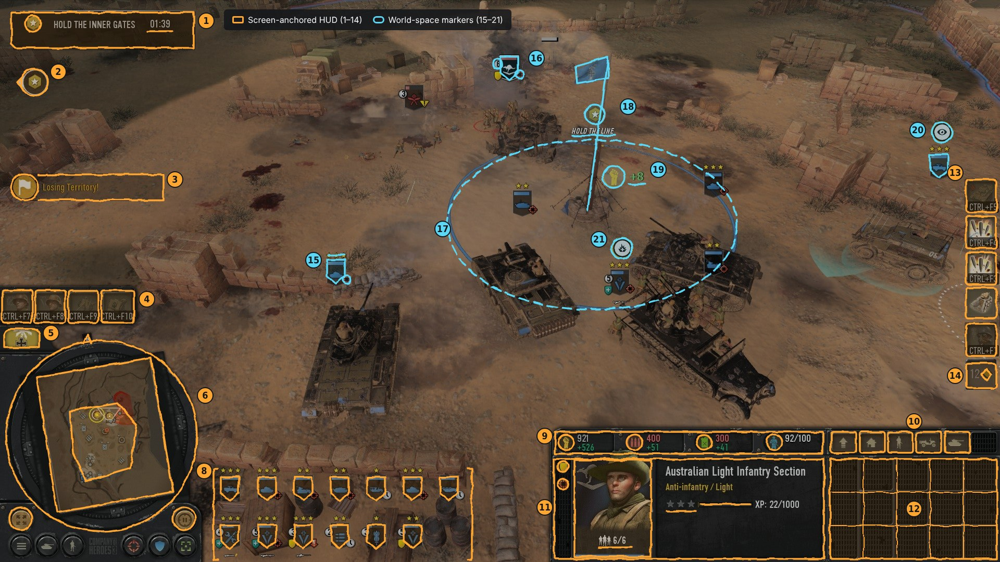
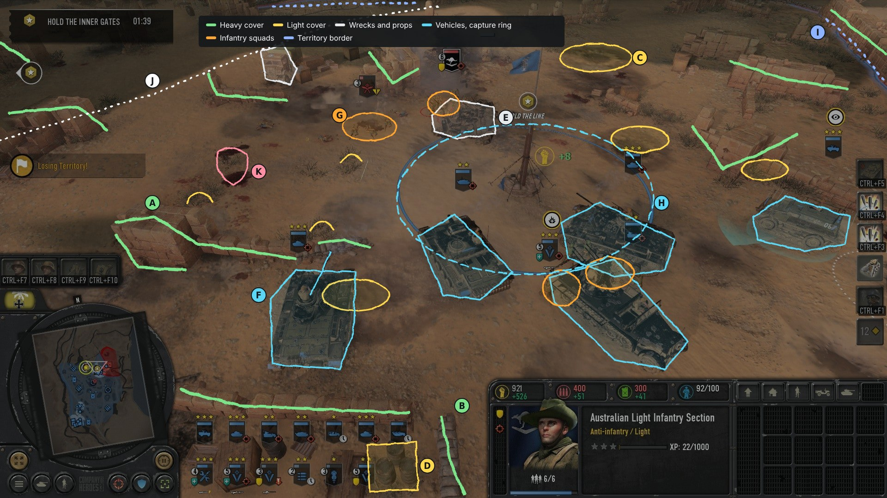
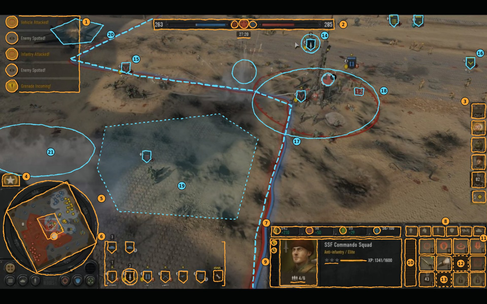
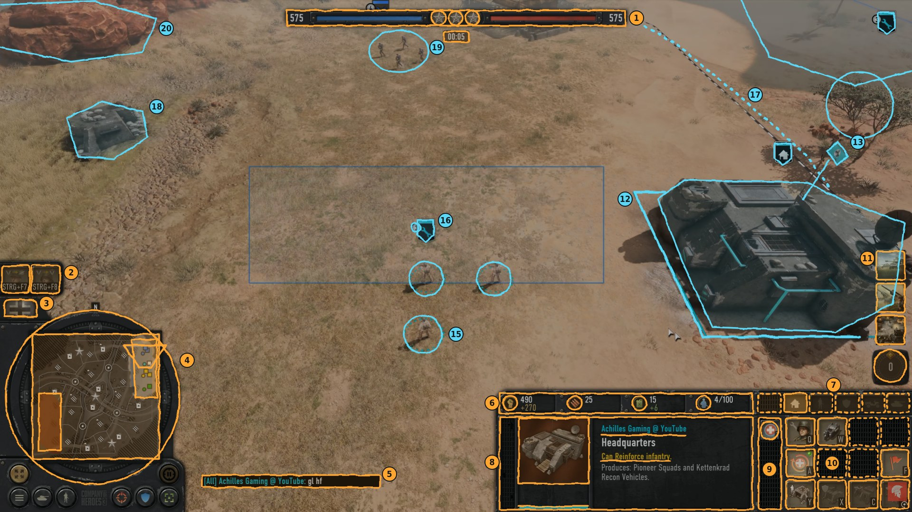
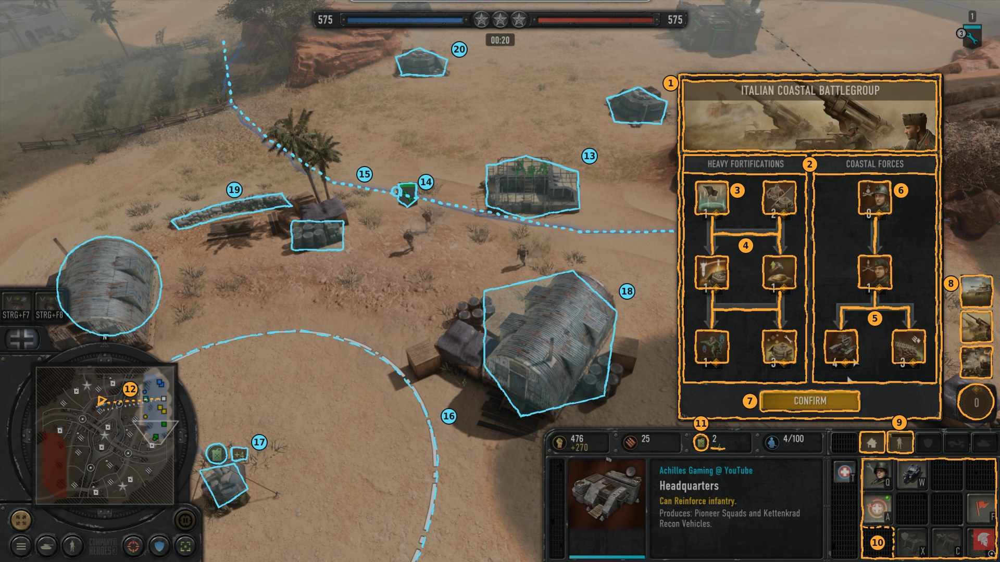
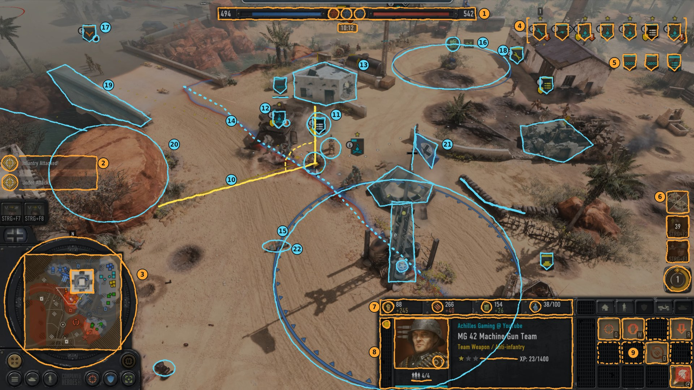
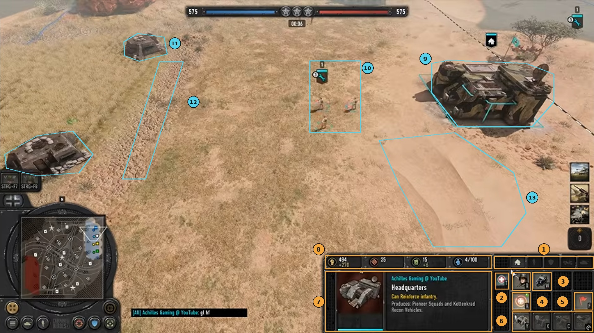
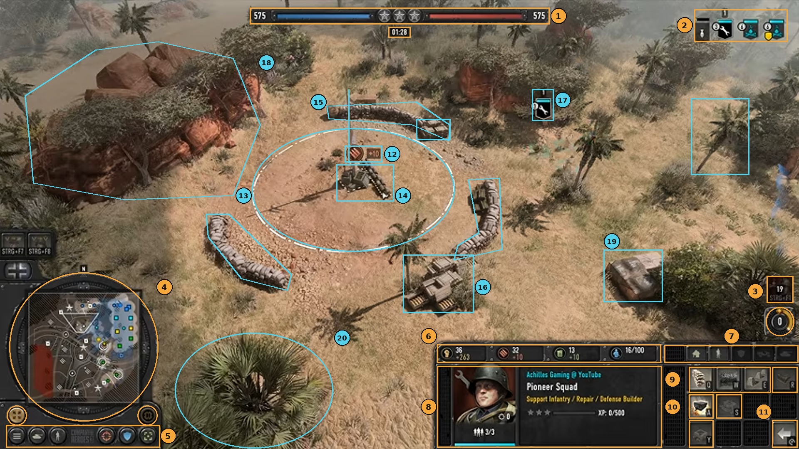
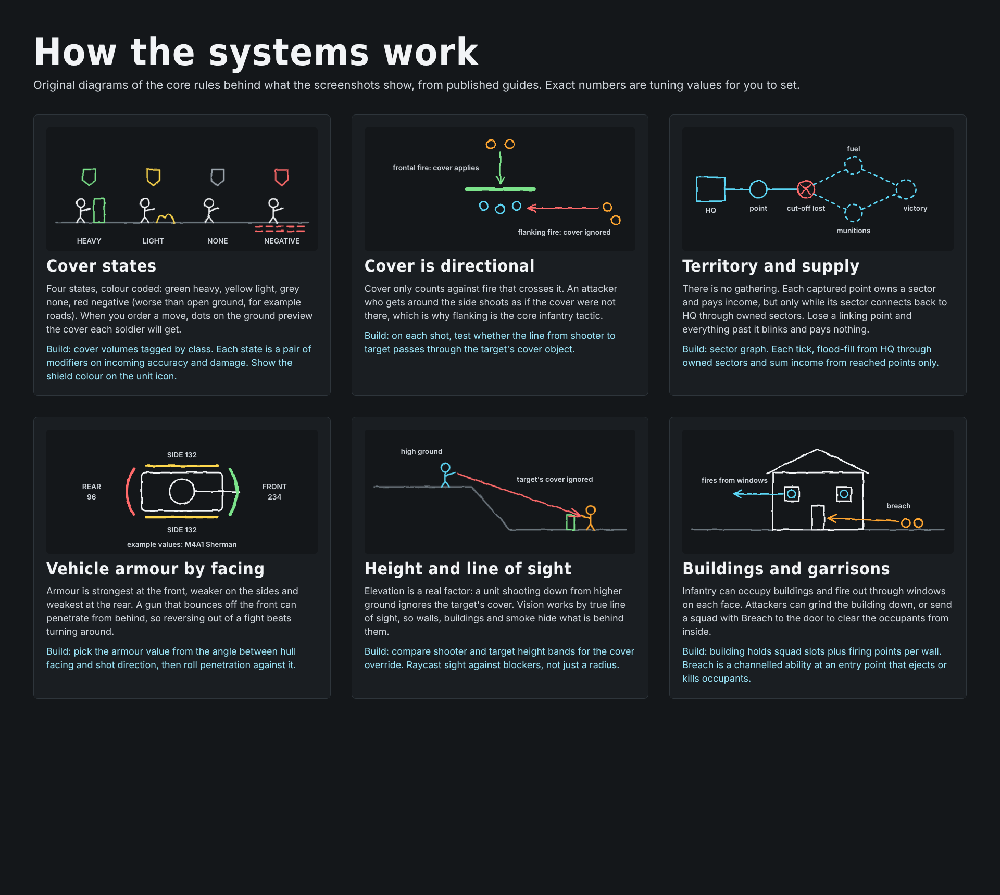

# Company of Heroes 3 HUD and gameplay reference

Annotated screenshots of Company of Heroes 3, used as the visual reference for this game's HUD, menus and battlefield
markers. Each screenshot has a traced overlay with numbered callouts and a legend: what the element shows, then a
build note for our version. This is a layout and function reference only: our icons and art are our own.

- `screenshots/`: the original captures.
- `boards/`: the annotated overlays (`.jpg`) and their legends (`-legend.png`), plus the systems diagrams.
- Orange callouts are fixed to the screen (HUD); blue callouts are markers in the game world.
- Each board numbers its own callouts. Gaps in the numbering are items dropped on review (multiplayer-only buttons,
  and the blue drag rectangle on the headquarters shot).
- The multiplayer button row under the minimap is out of scope and is not annotated.
- Hotkey labels such as STRG and Y/X/C come from a German keyboard layout in some captures.

| Board | What it covers |
|---|---|
| [Campaign HUD](#campaign-hud) | The full HUD in a campaign mission: objective, minimap, roster, resources, unit panel, command card |
| [Terrain, cover and units](#terrain-cover-and-units) | Cover classes, walls, craters, wrecks, vehicles, squads, capture ring, territory border |
| [Unit selected](#unit-selected-ssf-commando-squad) | A friendly squad selected: command card keys, veterancy, event feed, victory ticker |
| [Headquarters selected](#headquarters-selected) | Match start: building panel, production buttons, reinforce toggle, battlegroup choice |
| [Battlegroup panel](#battlegroup-panel) | Battlegroup unlock trees, node costs, pick-one pairs |
| [MG team and buildings](#mg-team-and-buildings) | Firing arc, team weapon card, structure roster, point ring styles, kill count |
| [Headquarters command card](#headquarters-command-card) | The HQ's card slot by slot, tab-to-building map, the four Wehrmacht buildings, starting economy, the HQ model |
| [Pioneers at a resource point](#pioneers-at-a-resource-point) | Build menu page, free and priced defences, point yield on hover, map-placed sandbags, upkeep, minimap buttons |
| [How the systems work](#how-the-systems-work) | Cover, flanking, territory supply, armour facing, height, garrisons |

## Campaign HUD

Original: [screenshots/01-campaign-hud.jpg](screenshots/01-campaign-hud.jpg) · Legend image: [boards/01-campaign-hud-legend.png](boards/01-campaign-hud-legend.png)

Numbers match the annotated screenshot above. 7 (multiplayer-only button row) and 22 are parked for now. Each entry says what the element shows, then a build note for the clone. Layout rule of thumb: status lives top-left, map bottom-left, the selected unit and its orders bottom-right, global abilities on the right edge, and the centre stays clear for the battlefield.

### Screen-anchored HUD

**1. Objective banner** Primary mission goal with a countdown timer (01:39) and an objective-type icon.
- *Build:* text + timer bound to mission script state. Collapse when no objective is active.

**2. Off-screen objective pointer** Objective icon with an arrow, clamped to the screen edge in the direction of an objective outside the view.
- *Build:* project the world position to screen, clamp to a margin, rotate the arrow. Click to jump the camera.

**3. Event alert** Timed toast ("Losing Territory!") with an event icon. Warns about things happening off-camera.
- *Build:* stacking queue with fade-out. Store the event position so a click focuses it.

**4. Call-in slots** Four special-ability slots with hotkeys (Ctrl+F7 to F10) for calling in reinforcements or triggering abilities. Dimmed means not available yet.
- *Build:* icon button with three states (ready, cooldown, locked) and a hotkey label strip.

**5. Faction badge** Emblem tab on top of the minimap frame showing which army you command. Likely opens the battlegroup screen.
- *Build:* static emblem per faction, optional button to the tech/battlegroup menu.

**6. Minimap** Rotated map inside a round frame. Blue fill is friendly territory, red is enemy. Shows unit pips, objective rings, capture points and a north marker. Round buttons on the frame: expand to tactical map (left) and pause (right).
- *Build:* render-texture of the map plus an icon layer. Left-click moves the camera, right-click issues orders.

**8. Army roster** One shield icon per unit you own: vehicles on the top row, infantry below. Each carries veterancy stars, a model-count badge, cover state (lower left) and status (lower right: in combat, busy clock, warning).
- *Build:* reuse the world-space unit decorator (15). Click selects, double-click centres the camera.

**9. Resource bar** Manpower 921 (+526), munitions 400 (+51), fuel 300 (+41), population 92/100. The green figure under each stock is income per minute.
- *Build:* four counters with icon, stock and rate. Flash a counter when an order fails for lack of it.

**10. Production shortcuts** Five tabs that jump to production buildings by category (HQ, base, infantry, light vehicles, armour) without moving the camera.
- *Build:* each tab selects that building and swaps the command card (12) to its build queue.

**11. Selected unit panel** Portrait, name, role tags (Anti-infantry / Light), three veterancy stars with an XP bar (22/1000), squad strength (6/6), health bar, and cover and combat state icons on the left edge. The unit shown appears to be an inspected enemy squad.
- *Build:* data-driven from the unit definition. Multi-select needs a compact grid variant.

**12. Command card** Grid of order and ability buttons for the selection. Empty here, consistent with an enemy unit being selected. Normally holds move, attack-move, stop, retreat, abilities and upgrades.
- *Build:* fixed grid with keys mapped to grid position. Buttons need cooldown sweep, cost and disabled states.

**13. Battlegroup abilities** Vertical strip of commander powers (off-map strikes, call-ins) with Ctrl+F hotkeys. Dimmed entries are locked or on cooldown.
- *Build:* same button component as 4, but targeted. Clicking enters a ground-target cursor mode.

**14. Command points** Unspent points (12) used to unlock battlegroup abilities. Earned over time through combat.
- *Build:* counter plus a button that opens the unlock tree. Pulse when a point is available.

### World-space markers

**15. Friendly unit decorator** Shield-shaped icon floating over each unit: team-colour bar on top (blue), unit-class glyph, veterancy stars above, combat badge at lower right.
- *Build:* one billboard widget at constant screen size, anchored above the unit. Reused in the roster (8).

**16. Enemy unit decorator** Same widget with a red bar and darker body. The number is models alive in the squad; the yellow shield marks light cover.
- *Build:* only draw when the unit is visible through fog of war. Colour comes from the owner relationship.

**17. Capture point** Flag pole with a ground ring showing the capture radius. Ring and flag take the owner's colour; the ring fills as control changes.
- *Build:* decal ring with a radial progress shader. Units inside the radius drive the capture timer.

**18. Objective world marker** Star icon with a label ("Hold the Line") pinned to the location the objective refers to. Pairs with the banner (1) and pointer (2).
- *Build:* same data source as the banner. When off-screen it becomes the edge pointer.

**19. Resource tick** Floating "+8" with the manpower icon, rising from a point when it pays out income.
- *Build:* pooled floating text. Spawn, drift upward, fade over about a second.

**20. Edge indicators** Decorators for things just outside the view, clamped to the screen edge: an eye icon (spotting or detection) and a friendly vehicle with its stars.
- *Build:* same clamp logic as 2, applied to units near the viewport.

**21. Ability-in-use marker** Round icon above a squad while it performs an ability (here a grenade-type icon).
- *Build:* temporary badge on the decorator stack, removed when the ability ends.

## Terrain, cover and units

Original: [screenshots/01-campaign-hud.jpg](screenshots/01-campaign-hud.jpg) · Legend image: [boards/02-terrain-cover-legend.png](boards/02-terrain-cover-legend.png)

Letters match the terrain trace above. Cover classes are my reading of the props in this shot based on how the series treats them; confirm in game before locking values.

## Unit selected (SSF Commando Squad)

Original: [screenshots/04-unit-selected.jpg](screenshots/04-unit-selected.jpg) · Legend image: [boards/04-unit-selected-legend.png](boards/04-unit-selected-legend.png)

Numbers match the second screenshot (a friendly SSF Commando Squad selected in a match with victory points). This board uses its own numbering. The multiplayer button row under the minimap is skipped.

### Screen-anchored HUD

**1. Event feed** Stack of five alerts, newest at the bottom. Icon colour shows the type: orange for units under attack, grey eye for enemies spotted, yellow for an urgent warning (Grenade Incoming!).
- *Build:* the single toast from the first shot is this list with one entry. Cap at five, expire by age, colour by severity.

**2. Victory ticker and match clock** Each team's remaining points (263 vs 285) with drain bars, three victory-point icons coloured by current owner, and the match time (27:20) below.
- *Build:* tick points off the side holding fewer victory points. Icons bind to point ownership. Replaces the objective banner in skirmish.

**3. Battlegroup abilities, live** The same right-edge strip, now unlocked: full-colour icons are ready, one shows an 82 countdown while it recharges, and the bottom tile shows 5 unspent command points.
- *Build:* three visual states per slot (locked, ready, cooldown with seconds overlay).

**4. Battlegroup tab** Star tab on the minimap frame. Sits where the faction emblem was in the first shot, so the tab graphic changes with the army or mode.
- *Build:* one button slot on the minimap frame, skinned per faction.

**5. Minimap in a team match** Blue and red territory fill, a white outline showing what the camera sees, a white ping ring, and yellow unit pips for an ally's forces.
- *Build:* draw the camera frustum projected onto the ground. Use a third colour for allies.

**6. Roster with selection** The selected squad's icon turns white with a ring. Small numbers above icons are control groups (1, 2, 3). The wrench tile at the end is an engineer squad (the wrench is the engineer class symbol, confirmed in the headquarters shot); the hazard stripe on it probably means it is busy building.
- *Build:* highlight state on the roster icon mirrors selection. Ctrl+number assigns a group and stamps the number.

**7. Resource bar** Same layout as before: manpower 642 (+210), munitions 98 (+50), fuel 99 (+29), population 58/100.
- *Build:* no change from the first board.

**8. Production tabs** Six tabs here against five in the campaign shot, so the count follows how many production buildings the faction has.
- *Build:* generate tabs from the faction's building list rather than hard-coding them.

**9. Unit panel, friendly** Portrait with a weapon icon, name, role tags (Anti-infantry / Elite), veterancy stars with a gold XP bar (1341/1600), squad strength 4/6 and a health bar. Left edge: cover shield and a rank chevron.
- *Build:* strength below maximum is the cue that the squad can reinforce. Fill a star when XP crosses its threshold.

**10. Slot column** Narrow dotted column between the panel and the command card, empty here. Likely holds picked-up weapons or squad upgrades.
- *Build:* vertical list of equipment icons owned by the squad. Confirm with a shot of an upgraded squad.

**11. Command card: orders row** Top row of the 4 by 3 grid holds the standard orders, each showing its key (Q, W, E, then a red retreat arrow). The keys follow the keyboard grid: QWER, ASDF, ZXCV.
- *Build:* bind by slot position, not by ability, so every unit uses the same finger for the same slot.

**12. Command card: abilities row** Middle row holds this squad's own abilities (A and S lit, F dimmed because it can't be used right now). Empty slots stay as dotted placeholders.
- *Build:* abilities come from the unit definition with a fixed slot index. Dim when cost or conditions fail.

**13. Command card: cooldown and locks** Bottom row: Z shows 43, the seconds left on a cooldown. C and V show padlocks, abilities not unlocked yet (likely by veterancy or an upgrade).
- *Build:* overlay a countdown number on cooling abilities and a lock on gated ones, with the requirement in the tooltip.

### World-space markers

**14. Selected unit decorator** The selected squad's icon turns white, with its control-group number above and model count at the side.
- *Build:* selected state on the decorator widget, matching the roster highlight.

**15. Enemy decorators** Red-barred icons with model counts and cover shields, shown only where your side can see them.
- *Build:* same widget as friendly units with owner colour swapped.

**16. Ally decorators** Yellow-barred icons, matching the yellow pips on the minimap. These are an ally's units.
- *Build:* three relationship colours: own, ally, enemy.

**17. Front line** A paired blue and red line across the ground where friendly and enemy sectors meet. It moves as points change hands.
- *Build:* draw each sector's outline in its owner's colour, so shared edges show both.

**18. Point being captured** Red ring around an enemy-held point, a flag icon with a circular progress fill, and a red "1.2" tag beside it (probably a capture-rate or income value).
- *Build:* radial progress on the point icon driven by the capture timer. Ring colour is the current owner.

**19. Tank traps** Field of concrete obstacles across the middle. They stop vehicles while infantry walk through, which shapes where armour can go.
- *Build:* obstacle type with a movement mask that blocks vehicles but not infantry.

**20. Aircraft overhead** A plane on fire at the top left. Off-map abilities bring in real aircraft models that fly over and can be shot down.
- *Build:* air abilities spawn a plane entity on a fixed path with health, not just an effect.

**21. Smoke and blast** A smoke bank on the left and a shell burst near the line. Smoke hides what is behind it.
- *Build:* smoke as a timed volume that blocks line of sight.

## Headquarters selected

Original: [screenshots/05-headquarters.png](screenshots/05-headquarters.png) · Legend image: [boards/05-headquarters-legend.png](boards/05-headquarters-legend.png)

Numbers match the third screenshot: five seconds into a skirmish with the HQ building selected. This is the opening state of every match, so it shows what the HUD looks like before anything is built or unlocked. Own numbering; the multiplayer button row is skipped.

### Screen-anchored HUD

**1. Victory ticker at start** Both sides start level at 575 with full bars. The three victory-point stars are grey because nobody owns them yet. Clock reads 00:05.
- *Build:* starting total is a match setting. Star icons have three states: neutral, friendly, enemy.

**2. Call-in slots** Only two slots here against four in the campaign shot, so the count depends on the army or mode. The label reads STRG, the German keyboard's Ctrl, so hotkey text is localised.
- *Build:* slot count from data. Pull key names from the input system, not hard-coded strings.

**3. Faction badge** Same emblem tab on the minimap frame as the first shot.
- *Build:* no change.

**4. Minimap at start** Mostly neutral map showing every capture point by type (circles, squares, stars for victory points), your base sector in blue, the enemy's in red, coloured squares for each player's start, and the white camera outline.
- *Build:* point icons are always visible even in fog. Only ownership colour and units are hidden.

**5. Chat line** Message bar above the bottom edge: channel tag ([All]), sender name in their team colour, then the text. Fades after a few seconds.
- *Build:* multiplayer only. Skip until networking exists.

**6. Resources at start** Manpower 490 (+270), munitions 25 with no income shown, fuel 15 (+6), population 4/100. Manpower flows from the start; munitions and fuel need captured points.
- *Build:* hide the income line when the rate is zero. Starting stock and base rates are match settings.

**7. Production tabs, mostly empty** Only the house tab (HQ) is lit. The others are dim placeholders that light up as each production building is constructed.
- *Build:* tab exists per building type, enabled only when you own one. Lit tab marks the building currently selected.

**8. Building info panel** Same panel as for units, with different content: picture of the building, owner's name in team colour, building name, a yellow highlight line (Can Reinforce infantry), a short description of what it produces, and a health bar underneath.
- *Build:* one panel template with optional fields. Buildings have no veterancy, XP or squad count.

**9. Reinforce toggle (T)** The red-cross button in the narrow column next to the command card switches reinforcement off and back on for squads with missing models.
- *Build:* a toggle outside the 4 by 3 grid. When on, under-strength squads near a reinforce point refill and spend manpower; when off, they hold as they are.

**10. Command card for a building** Top row: units to produce, shown as portraits (Q infantry squad, W light vehicle). Middle row: a toggle on A with a green active light, and a flag on F that looks like set rally point. Bottom row: upgrades or tech, most dimmed, one with a small clock badge. Keys read Y, X, C because of the German layout.
- *Build:* production buttons queue a unit and show progress on the button. Dim when unaffordable or locked, and say why in the tooltip.

**11. Battlegroup choice** Before any battlegroup is picked, the right edge shows three picture tiles (the options) and a dial reading 0 command points. After picking, this becomes the ability strip seen in the other shots.
- *Build:* two states for this strip: choose one of N, then show that choice's abilities.

### World-space markers

**12. Selected building** Selection shows as a cyan outline around the building's ground footprint plus glowing edge lines on the model, with a house-icon decorator above it.
- *Build:* footprint decal for selection, and the same shield widget as units with a building glyph.

**13. Rally flag** Small cyan flag beside the HQ. New units walk here after they are produced.
- *Build:* per-building rally position, shown only while the building is selected.

**15. Per-soldier rings** Dotted cyan circle under each of the three soldiers. Every model in a squad gets its own ground ring when hovered or about to be selected.
- *Build:* ring decal per model, dotted for hover and solid for selected.

**16. Engineer decorator** Unit icon with a wrench glyph and a 3 (three men). The wrench is the class symbol for engineer squads. A second one is pinned to the top-right screen edge for a squad off screen.
- *Build:* one glyph per unit class. This also explains the wrench tile in the commando shot's roster.

**17. Base boundary** Black and white dashed line across the ground at the top right, different from the solid coloured sector lines. Appears to mark the edge of the base sector.
- *Build:* a separate line style for the HQ sector, which cannot be captured.

**18. Neutral structure** Ruined stone emplacement at the left. Map objects like this can be cover or a garrison position for whoever reaches them first.
- *Build:* neutral building type with garrison slots and health.

**19. Squad in motion** Four soldiers moving in a loose spread, not a tight block, with their decorator riding above the group.
- *Build:* formation offsets per model with a little random spacing. Decorator follows the squad's centre.

**20. Map edges and blockers** Red rock cliffs at the top left, a tree, and water at the top right. These bound where units can go and what they can see past.
- *Build:* impassable and sight-blocking masks painted on the map, separate from cover objects.

## Battlegroup panel

Original: [screenshots/06-battlegroup.png](screenshots/06-battlegroup.png) · Legend image: [boards/06-battlegroup-legend.png](boards/06-battlegroup-legend.png)

Numbers match the fourth screenshot: twenty seconds in, with the battlegroup preview open before confirming the choice. Own numbering; the multiplayer button row is skipped.

### Screen-anchored HUD

**1. Battlegroup panel** Floating panel that opens beside the three choice tiles on the right edge. Header shows the battlegroup's name over banner art. The game keeps running behind it.
- *Build:* non-modal popover anchored to the tile that opened it. Clicking another tile swaps the content.

**2. Two branches** Each battlegroup splits into two named columns (Heavy Fortifications, Coastal Forces). Each column is its own small unlock tree.
- *Build:* battlegroup = name, art, and two branch definitions. Keep the data shape the same for every battlegroup.

**3. Ability node** Square icon with its price underneath: a number and the yellow command-point diamond. Costs here run from 0 to 4.
- *Build:* node = icon, cost, description, and what it grants (a call-in, an ability, or a passive bonus). Hover shows a tooltip.

**4. Connectors** Grey arrows run top to bottom, so lower nodes need something above them unlocked first. In the left branch each row is a pair joined by a crossbar, and each pair is pick one: taking one node locks out its partner.
- *Build:* each node lists its prerequisite nodes plus an "excludes" partner. Unlocking one greys out the other for the rest of the match.

**5. Branching split** The right branch runs single file for two nodes, then forks into two end nodes (costs 4 and 3). So tree shapes differ between branches.
- *Build:* draw connectors from the prerequisite data, not from a fixed grid.

**6. Free starting node** The top node of the right branch costs 0, so it can be taken immediately even with no command points.
- *Build:* allow zero-cost nodes. They give a new battlegroup something to use from the first minute.

**7. Confirm button** Gold button at the bottom. The panel is a preview until this is pressed, and the choice then holds for the rest of the match.
- *Build:* browse freely, commit once. After confirming, the edge tiles turn into that battlegroup's ability strip.

**8. Choice tiles and point dial** The three battlegroup tiles and the command-point dial (0) stay visible beside the panel.
- *Build:* same strip as on the headquarters board. Dial count feeds the node costs in the panel.

**9. Second production tab lit** The infantry tab next to the house is now lit, where it was dim fifteen seconds earlier. A new production building has been started.
- *Build:* tab appears as soon as the building is placed, not only when finished.

**10. Command card changed** The bottom-left slot (Y) that held a button in the previous shot is now empty. Buttons leave the card once their one-time action is used.
- *Build:* one-shot actions such as constructing a unique building remove their own button.

**11. Fuel spent** Fuel has dropped from 15 to 2 and manpower from 490 to 476, matching the new construction.
- *Build:* deduct cost when the order is placed and refund if it is cancelled.

**12. Order path on minimap** A dotted line with a small flag runs across the minimap, showing where a unit has been sent.
- *Build:* draw the selected unit's queued destination on the minimap as well as in the world.

### World-space markers

**13. Building under construction** A scaffold frame stands where the building will be, with green figures marking the engineers assigned to it.
- *Build:* placement creates a scaffold object with a build-progress value. Engineers in range add progress.

**14. Engineer decorator, green** The same wrench icon as before, with a green top bar where the last shot had blue. The bar shows the player's team colour, and the player is on a different team in this match.
- *Build:* decorator bar, selection outlines and minimap pips all read from one per-player colour assigned at match start.

**15. Sector line** Thin blue line across the sand marking the edge of friendly territory.
- *Build:* same sector outline as on the other boards.

**16. Point outline** White dash-dot arc sweeping across the lower half of the view: the outline of a capture point's area. White here because the point is not owned yet; the rings on the other boards are blue or red for their owner.
- *Build:* one ring decal per point, sized to its capture radius, with colour and line style set by ownership state (neutral, friendly, enemy).

**17. Resource point paying out** A fuel icon with "+4" floats over a small structure at the lower left: a fuel point delivering income.
- *Build:* same floating tick as the "+8" on the first board, with the icon set by resource type.

**18. Huts** Two corrugated metal huts. Large map buildings like these block sight and movement and may be garrisonable.
- *Build:* neutral building type; garrison slots optional per building.

**19. Sandbags, crates and barrels** A curved sandbag wall with stacked supplies behind it. Ready-made cover near the base.
- *Build:* map-placed cover objects using the same classes as player-built ones.

**20. Bunkers** Two low concrete bunkers on the far side of the sector line.
- *Build:* neutral defensive structures that either side can occupy.

## MG team and buildings

Original: [screenshots/07-mg-team-buildings.png](screenshots/07-mg-team-buildings.png) · Legend image: [boards/07-mg-team-buildings-legend.png](boards/07-mg-team-buildings-legend.png)

Numbers match the fifth screenshot: ten minutes in, an MG 42 team selected and set up beside a building, holding a victory point. Own numbering. Only elements that add something new are called out; the call-in slots, faction badge and production tabs are as on earlier boards.

### Screen-anchored HUD

**1. Victory ticker mid-match** 494 against 542, and the three stars are now coloured: one red, two blue. The blue side holds two of three, so the red total should be the one draining.
- *Build:* each star takes its owner's colour the moment a victory point flips.

**2. Alerts** Two alerts (Infantry Attacked!, Under Attack!) stacked just above the call-in slots, each with a diamond icon. A different spot from the top-left stack in the commando shot, so the feed's position varies with layout or version.
- *Build:* pick one anchor for the feed and keep it. Above the minimap keeps the eye near the map.

**3. Minimap alert marker** Bold white square brackets on the minimap mark where the attack is happening. Territory is now carved into blue and red sectors with allied pips in several colours.
- *Build:* each alert drops a flashing marker at its map position for a few seconds. Clicking the alert jumps there.

**4. Unit roster, top right** The army roster sits along the top-right edge here, where the first shots had it bottom centre. Its position is a layout setting. Same icons: stars above for veterancy, model count at left, cover shield, a red "!" on units under fire, and the selected unit in white.
- *Build:* roster as one component whose anchor is a layout setting. Sort by control group, then unit class.

**5. Structure icons** A second, shorter row under the roster with brick-pattern glyphs. These are the player's built structures and emplacements, listed apart from mobile units.
- *Build:* second roster row filtered to buildings. Click to select or jump to them.

**6. Battlegroup strip in use** After confirming a battlegroup the three choice tiles become its abilities: one crossed out (not available), one counting down from 39, one dimmed. The dial reads 1 with a gold arc showing progress to the next command point.
- *Build:* radial fill on the dial driven by XP toward the next point.

**7. Resources mid-match** Manpower is low at 88 (+245) while munitions (266, +40) and fuel (154, +26) have built up. Population 38/100.
- *Build:* no change. Income lines now show for all three because points are held.

**8. Unit panel, team weapon** Role tags read Team Weapon / Anti-infantry. One gold star of three, XP 23/1400, crew 4/4. Two extras on the portrait: a weapon icon at the top left and a crosshair with "1", the unit's kill count.
- *Build:* optional portrait overlays for carried weapon and kills. First star filled gold, the rest grey.

**9. Command card, team weapon** Fewer buttons than the commandos: two orders on Q and W, retreat on R, attack ground on D (fire at a spot on the ground, not at a unit), and one icon at the bottom right. The rest of the grid is empty.
- *Build:* same grid and slot keys for every unit; the unit definition decides which slots are filled.

### World-space markers

**10. MG firing arc** Two yellow lines run out from the gun, marking the edges of the cone it can fire into. Anything outside the cone is safe from it until the crew picks up and turns.
- *Build:* weapon has a facing and an arc angle. Draw the two edge lines to weapon range while selected. Re-facing takes a setup delay.

**11. Selected team and crew rings** The MG team's icon is white with a star above it, and dotted rings sit under individual crew members.
- *Build:* same selected state as other units. Team weapons mark the gunner model separately from the crew.

**12. Under-fire badge** A red "!" on the lower corner of a friendly squad's icon. The same badge appears on several icons in the roster.
- *Build:* set the badge when the unit took damage in the last few seconds; mirror it in the roster.

**13. Building with its own icon** The house beside the MG has a decorator with a brick glyph and a small bar under it. The brick glyph is the class symbol for buildings, so they get an icon like units do. The bar is probably health or occupancy.
- *Build:* building decorator shows owner colour once garrisoned, plus a health bar when damaged.

**14. Front line** Blue and red paired line running diagonally through the fight, right past the MG position.
- *Build:* as on the commando board.

**15. Victory point, owned** A tower with a star badge at its base, surrounded by a heavy blue ring with small triangles pointing inward. The thick line with tick marks sets victory points apart from ordinary points.
- *Build:* ring style by point type. Victory points get the heavy ticked ring and a star marker.

**16. Fuel point, owned** A thin blue ring with a fuel icon and "+4" above it. Same point outline as the white one on the battlegroup board, now in the owner's colour.
- *Build:* confirms the outline colour follows ownership: white neutral, team colour when held.

**17. Enemy decorator, orange** The enemy squad at the top left has an orange bar, where earlier shots had red. Enemy colour varies by player like friendly colour does.
- *Build:* per-player colours for everyone, with an option to force simple friend/foe colours.

**18. Ally decorators** Yellow-barred icons around the right-hand building and a yellow tank icon lower right: an ally's units sharing the position.
- *Build:* as before, a third relationship colour.

**19. Bridge and water** A stone bridge over a river at the left. Water blocks movement, so the bridge is the only crossing and a natural place to defend.
- *Build:* bridges as destructible, repairable path links across impassable water.

**20. Rocks, tyre wall and wreck** A large boulder, a curved wall of stacked tyres and sandbags, and a burnt-out vehicle. The boulder blocks everything; the wall and wreck are cover.
- *Build:* same cover classes as the terrain board.

**21. Built emplacement with flag** A small fortified position with a faction flag flying over it, next to the victory point.
- *Build:* player-built defences fly the owner's flag so ownership reads at a glance.

**22. Casualties** Fallen soldiers stay on the ground where they dropped.
- *Build:* bodies persist for a while, then fade. Dropped weapons could stay as pick-ups.

## Headquarters command card

Original: [screenshots/08-headquarters-command-card.jpg](screenshots/08-headquarters-command-card.jpg) · Legend image: [boards/08-headquarters-command-card-legend.png](boards/08-headquarters-command-card-legend.png)

Numbers match the sixth screenshot: the same match as the headquarters board, one second later (00:06), with the Wehrmacht HQ still selected. That board covers the HUD at match start; this one goes slot by slot through the HQ's command card, the production tabs and the building itself. Own numbering. Costs, times and health are from CoH3 game data ([coh3stats.com](https://coh3stats.com/explorer/races/german)) and Relic's patch notes; confirm in game before locking values. Items 4 and 12 were confirmed in review.

### Screen-anchored HUD

**1. One tab per building** After an empty slot come five tabs: house (Headquarters), soldier (Infanterie Kompanie), shield (Luftwaffe Kompanie), half-track (Panzergrenadier Kompanie) and tank (Panzer Kompanie). That is the Wehrmacht's full building list, in tech order, and the same four buildings sit on the card's bottom row (6). Only the house is lit.
- *Build:* tabs = the HQ plus each production building in the faction data, in tech order; lit once you own one (board 06, item 9).

**2. T: red cross** Red cross with T at the top of the slot column, outside the 4 by 3 grid. Board 05 read this as the reinforce toggle, but the confirmed auto-reinforce toggle is A (4), so T is a separate building-level control; check its tooltip.
- *Build:* building-level controls live in the slot column, not the grid.

**3. Production row: Q and W** Units are shown as portraits. Q Pioneer Squad (125 manpower, 4 population, 18 s, 3 men). W Kettenkrad Recon Vehicle (160 manpower, 2 population, 20 s): unarmed, fast, captures points 1.5 times as fast as infantry. Population reads 4/100: exactly the one starting Pioneer squad.
- *Build:* production buttons are unit portraits; the tooltip shows cost, population and build time.

**4. A: auto-reinforce toggle** Red cross inside orange circular arrows, green light at the corner: the automatic reinforcement toggle, switched on (confirmed). While on, squads that have lost models are refilled automatically near the HQ, and every replacement model costs manpower (Pioneers about 22 a man). Off, squads stay under strength and the manpower is kept.
- *Build:* per-player auto-reinforce flag on reinforce points; each model refilled charges the unit's reinforce cost. Toggle state shown as a corner light: green on, none off.

**5. F: set rally point** Red flag on F, the far-right slot of the middle row. Click it, then click the ground; the cyan flag beside the HQ (board 05, item 13) marks the result.
- *Build:* rally point is a targeted order on every production building, always in the same slot.

**6. Bottom row: the four buildings** Y Infanterie Kompanie is lit (80 manpower, 15 fuel). X Luftwaffe (150, 50 fuel), C Panzergrenadier (150, 40) and V Panzer Kompanie (300, 135) are dim: unaffordable at 15 fuel, possibly also locked. By 00:20 (board 06) the Y button had vanished, a scaffold stood with Pioneers at it, and fuel had fallen from 15 to 2, which matches the Infanterie Kompanie's price. So buildings are ordered from the HQ card and raised by Pioneers.
- *Build:* the HQ card holds one place-building button per tier; it charges on placement, then the button leaves the card.

**7. Building panel** Owner name, Headquarters, the yellow Can Reinforce infantry line, then Produces: Pioneer Squads and Kettenkrad Recon Vehicles. The portrait is a small render of the HQ; the cyan bar under it is building health (3,000 in CoH3 data, the most of any Wehrmacht building).
- *Build:* generate the Produces line from the building's unit list.

**8. Starting economy** Manpower 494 (+270), munitions 25 with no rate, fuel 15 (+6), population 4/100. Fuel trickles in at +6 a minute with no points held: a base income. Relic's update 3.0 raised starting fuel income from 3 to 6 in every mode, which matches.
- *Build:* base income: manpower 270 and fuel 6 per minute, munitions 0 until points are held; all match settings.

### World-space markers

**9. The Headquarters** A dug-in command post, not a house: a low armoured box in camouflage paint with a hatch on the roof, piled sandbags and debris on its flanks, and a radio dish at the back. It sits in the corner of the base, right against the base boundary. Selected, it shows the cyan footprint and edge glow from board 05.
- *Build:* our HQ: a low fortified command post with a radio mast, present at match start, cannot be built or moved, about 3,000 health.

**10. Starting Pioneers** Three Pioneers walking out from the HQ with their decorator (3 men, control group 1) above them. The whole starting army is this one squad; everything else comes from the HQ card. A matching decorator is pinned to the top-right screen edge.
- *Build:* match start spawns one engineer squad per player beside the HQ, already in control group 1.

**11. Concrete bunkers** Two concrete bunkers just outside the base, ringed with stones. Neutral emplacements either side can occupy; Pioneers can build the same kind of Concrete Bunker for 175 manpower.
- *Build:* neutral bunker type with garrison slots and health, shared with the buildable one.

**12. Rubble strip, not a trench** A stony strip runs from the top bunker down towards the left one. Confirmed not a trench: it is gravel or rubble on the ground surface, linking the two bunkers visually.
- *Build:* ground decal only; no cover or movement effect unless testing shows otherwise.

**13. Dune ridge** A raised sand ridge in front of the HQ. Height counts in CoH3: units on top shoot down past the target's cover (systems board), so the ridge is the strongest ground near the base.
- *Build:* paint height bands into the map; the cover override reads them.

## Pioneers at a resource point

Original: [screenshots/09-pioneer-build-point.jpg](screenshots/09-pioneer-build-point.jpg) · Legend image: [boards/09-pioneer-build-point-legend.png](boards/09-pioneer-build-point-legend.png)

Numbers match the seventh screenshot: 01:28 into a skirmish, a Pioneer squad selected with its construction menu open while the cursor hovers a neutral munitions point ringed by sandbags. Own numbering; call-in slots and the faction badge are as on earlier boards. Costs and times are from CoH3 game data ([coh3stats.com](https://coh3stats.com/explorer/races/german/units/pioneer_ger)); confirm in game before locking values.

### Screen-anchored HUD

**1. Victory ticker at 01:28** Still 575 to 575 with all three stars grey a minute and a half in. Nobody holds a victory point yet, so neither total has moved.
- *Build:* drain only runs while one side holds more victory points than the other; level means no tick.

**2. Army roster, early** Top-right anchor as on board 07. From the left: a dark tile with a small progress bar on top (probably a unit still in production), the Pioneers (wrench, 3 men, control group 1), then two infantry squads with model counts, one showing a yellow light-cover shield.
- *Build:* give a queued unit its roster tile with a progress bar as soon as it is bought; it becomes the normal icon when the unit spawns.

**3. Battlegroup picked** The three choice tiles from boards 05 and 06 are gone. One ability tile with a portrait, a 19 countdown and STRG+F1 sits above the command-point dial, which reads 0 with a gold arc about two-thirds round. A battlegroup has been confirmed and its first ability is recharging; probably the free 0-cost node (board 06, item 6).
- *Build:* after confirming, show only unlocked abilities in the strip; the dial's arc is progress to the next command point.

**4. Minimap point types and teams** Four point glyphs: stars (victory points), plain squares, circles and hatched diamonds, so the glyph shape is the point type. Own units blue, allies cyan, yellow and green (a four-a-side match), enemy base sector red at the left, white camera triangle at the top. A few points carry a white glow ring, likely being captured.
- *Build:* one glyph per point type, always drawn even in fog; pip colour comes from the player slot (own, each ally, enemy).

**5. Minimap button row** The row skipped on earlier boards. Menu, then the tank button (selects all vehicles) and the soldier button (selects all infantry), both confirmed; the game logo; then three pings: red crosshair (attack here), blue shield (defend here) and a green frame (probably focus here). Above it: the gold tactical-map button at the left and pause at the right.
- *Build:* menu, select-all and tactical map are needed in single player; pings wait until there are allies to read them.

**6. Resources and upkeep** Manpower 38 (+263), munitions 32 (+10), fuel 13 (+10), population 16/100. Manpower income has dropped from +270 at the start (board 08) to +263: upkeep. Every unit on the field costs manpower per minute (Pioneers 4.2), so a bigger army earns less.
- *Build:* net manpower rate = base income minus the sum of unit upkeep; show the net figure.

**7. Second tab lit** House (HQ) and soldier tabs are lit, so the Infanterie Kompanie stands by 01:28. Shield, half-track and tank tabs are still dim. Board 08 maps each tab to its building.
- *Build:* no change from boards 05 and 06.

**8. Pioneer unit panel** Role tags read Support Infantry / Repair / Defense Builder. XP 0/500 matches the Pioneers' first veterancy step (500, then 1,500 and 3,000). Squad 3/3 (Pioneers are three men, 125 manpower, 4 population). The portrait carries a wrench class badge and a small 0 at its lower right, probably kills.
- *Build:* veterancy thresholds are per-unit data, e.g. Pioneers [500, 1500, 3000].

**9. Build menu: field defences** The command card has switched to the Pioneers' construction page. Q sandbag wall, W barbed wire, E tank trap: all free, paid in build time only (6 s, 3 s and 9 s). Sandbags give heavy cover. Wire stops infantry and is crushed by heavier vehicles. Tank traps stop vehicles, give heavy cover, and only heavy tanks break through.
- *Build:* free defences are placed by dragging a line; cost is build time, not resources.

**10. Build menu: priced items** R, S and Y are greyed while A is lit. That fits the prices against 38 manpower and 32 munitions: manpower builds such as the Fighting Nest (50), Concrete Bunker (175) and Resource Cache (200) are out of reach, while A, an explosive (a Schu-mine is 30 munitions), is affordable. The Pioneers can build 17 things in all, so the page shows a subset.
- *Build:* grey a build button whenever its cost or prerequisite isn't met, and name what's missing in the tooltip.

**11. Back to orders** A large back arrow in the bottom-right slot returns the card to the squad's normal orders. Construction is a second page of the same 4 by 3 grid, so build items reuse the grid keys.
- *Build:* command card pages: orders and build. The back button always takes the bottom-right slot.

### World-space markers

**12. Point yield on hover** A munitions icon with a +10 tag floats over the point while the cursor rests on it: the point's yield, +10 munitions per minute. The red 1.2 tag on board 04 is probably the same readout.
- *Build:* hovering a point shows its resource type and income per minute.

**13. Neutral capture ring** White dash-dot ring: the capture radius of a point nobody owns, sized well past the sandbags' inner edge.
- *Build:* same ring decal as board 06 (16); white while neutral.

**14. Munitions point model** A bare flagpole with ammunition crates and a loose belt of rounds at its foot. The prop tells you the point type before you read any icon. No flag is up while it is neutral.
- *Build:* point = pole plus a resource-type prop; the flag climbs the pole with capture progress.

**15. Map-placed sandbags** Three curved sandbag walls ring the point at 01:28, too long and too early to be player-built: cover that ships with the map. Sandbags are heavy cover and face outward, so an attacker has to flank or go around them.
- *Build:* maps place cover lines around key points using the same object Pioneers build.

**16. Supply crates** Stacks of crates and ammunition boxes at the ends of the walls. Probably light cover that breaks when shelled.
- *Build:* small destructible props with a light-cover tag.

**17. Pioneers in the scrub** Wrench decorator, 3 men, control group 1 above it: the squad shown in the panel, standing in the tree line. The men are hidden in the scrub but the decorator still draws.
- *Build:* decorators draw even when foliage hides the models.

**18. Rock outcrops** Red rock and raised ground on the left. Blocks movement and sight; units on top shoot down past cover (systems board).
- *Build:* impassable, sight-blocking mask with a height band on top.

**19. Concrete block** A broken concrete block at the right: heavy cover that nobody built and that only explosives remove.
- *Build:* neutral heavy-cover prop with health.

**20. Palms and scrub** Palms and dense scrub everywhere. They break up sight lines; whether they also give cover is not clear from the shot.
- *Build:* keep a concealment tag separate from the cover classes; confirm in game.

## How the systems work

Original diagrams of the core rules, drawn from published guides. Exact numbers are tuning values to set.

**Cover states.** Four states, colour coded: green heavy, yellow light, grey none, red negative (worse than open ground, for example roads). When you order a move, dots on the ground preview the cover each soldier will get.
- *Build:* cover volumes tagged by class. Each state is a pair of modifiers on incoming accuracy and damage. Show the shield colour on the unit icon.

**Cover is directional.** Cover only counts against fire that crosses it. An attacker who gets around the side shoots as if the cover were not there, which is why flanking is the core infantry tactic.
- *Build:* on each shot, test whether the line from shooter to target passes through the target's cover object.

**Territory and supply.** There is no gathering. Each captured point owns a sector and pays income, but only while its sector connects back to HQ through owned sectors. Lose a linking point and everything past it blinks and pays nothing.
- *Build:* sector graph. Each tick, flood-fill from HQ through owned sectors and sum income from reached points only.

**Vehicle armour by facing.** Armour is strongest at the front, weaker on the sides and weakest at the rear. A gun that bounces off the front can penetrate from behind, so reversing out of a fight beats turning around.
- *Build:* pick the armour value from the angle between hull facing and shot direction, then roll penetration against it.

**Height and line of sight.** Elevation is a real factor: a unit shooting down from higher ground ignores the target's cover. Vision works by true line of sight, so walls, buildings and smoke hide what is behind them.
- *Build:* compare shooter and target height bands for the cover override. Raycast sight against blockers, not just a radius.

**Buildings and garrisons.** Infantry can occupy buildings and fire out through windows on each face. Attackers can grind the building down, or send a squad with Breach to the door to clear the occupants from inside.
- *Build:* building holds squad slots plus firing points per wall. Breach is a channelled ability at an entry point that ejects or kills occupants.

